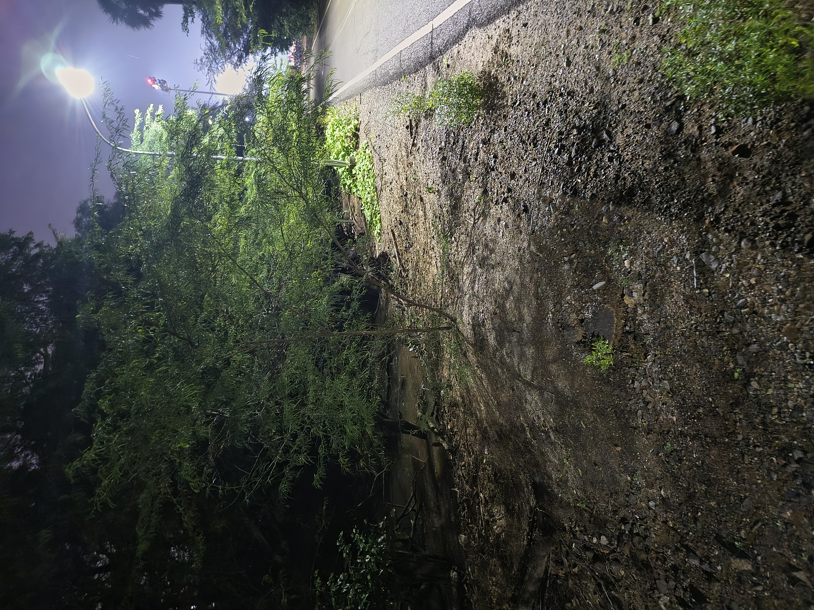
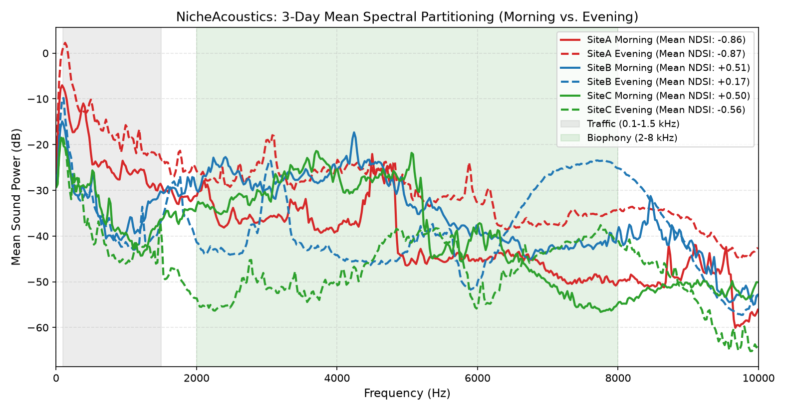

<div align="center">

# 🌿 NicheAcoustics
### Evaluating the Acoustic Niche Hypothesis Across an Urban-to-Forest Gradient

[](https://www.python.org/)
[](https://librosa.org/)
[](#2-field-study-sites--habitat-documentation)
[](#4-quantitative-results--spectral-partitioning-analysis)

*An end-to-end Digital Signal Processing (DSP) and bioacoustics pipeline measuring how natural soundscapes recover across Chennai's urban-forest transition.*

**Author:** Ojasvi Kumar  |  **Sampling Protocol:** 3 Consecutive Days (`Thu–Sat`)  |  **Windows:** Dawn (`~06:00–06:30 IST`) & Dusk (`~18:00–18:30 IST`)

</div>

---

## 1. Overview & Motivation

As cities expand and vehicular traffic increases, man-made noise encroaches upon nearby forest ecosystems and reduces the acoustic space available for wildlife communication. According to Bernie Krause's **Acoustic Niche Hypothesis (ANH)**, healthy ecosystems naturally divide the sound spectrum into distinct, non-overlapping frequency bands—allowing birds, insects, and amphibians to communicate simultaneously without interfering with one another. In contrast, urban traffic noise ($0.1\text{--}1.5\text{ kHz}$) masks biological calls ($2.0\text{--}8.0\text{ kHz}$).

**NicheAcoustics** analyzes **18 uncompressed 60-second field recordings** (`44.1 kHz`, 16-bit Mono WAV) collected across a three-site transect spanning the **IIT Madras Campus** and the **Guindy National Park** forest boundary in Chennai, India. Using **Power Spectral Density (PSD)** analysis, the pipeline evaluates three standardized ecoacoustic metrics alongside frequency-power plots to measure how soundscapes change from the busy campus gate to the quiet forest interior.

---

## 2. Field Study Sites & Habitat Documentation

| Site ID | Ecological Zone | Landmark / Location | GPS Coordinates | Habitat & Acoustic Profile |
| :--- | :--- | :--- | :--- | :--- |
| **Site A** | **Urban Perimeter Control** | IIT Madras In-Gate Rd / Main Gate Roundabout | `13.005440, 80.241901` | Multi-lane paved entry roundabout adjacent to security gates and Sardar Patel Rd arterial traffic; manicured lawn strips and sparse ornamental trees. |
| **Site B** | **Buffered Campus Interior** | Ground Road near SAC Rd & Vindhya Mess | `12.990387, 80.235948` | Tree-lined internal campus road (~1.5 km from perimeter highways) flanked by dense shrubs, overhanging canopy, and damp wooded undergrowth. |
| **Site C** | **Deep Forest Refuge** | Madras Avenue (Guindy National Park Border) | `13.000776, 80.238422` | Closed-canopy tropical dry evergreen forest corridor with mature banyan aerial roots, thick leaf litter, and zero through-traffic. |

---

### 📍 Site A — Urban Perimeter Control (`13.005440, 80.241901`)
> **Acoustic Regime:** Constant low-frequency traffic dominance (`0.1–1.5 kHz`) during both morning (`-0.86` NDSI) and evening (`-0.87` NDSI).

<table>
  <tr>
    <th width="42%">GPS Location Pin</th>
    <th width="58%">Ground Habitat View</th>
  </tr>
  <tr>
    <td align="center">
      
    </td>
    <td align="center">
      
    </td>
  </tr>
  <tr>
    <th colspan="2">360° Horizon Panorama</th>
  </tr>
  <tr>
    <td colspan="2" align="center">
      
    </td>
  </tr>
</table>

---

### 📍 Site B — Buffered Campus Interior (`12.990387, 80.235948`)
> **Acoustic Regime:** Clear day-to-night biological shift — vibrant bird chorus at dawn (`+0.51` NDSI) followed by a loud insect chorus at dusk (`+0.17` NDSI).

<table>
  <tr>
    <th width="42%">GPS Location Pin</th>
    <th width="58%">Ground Habitat View</th>
  </tr>
  <tr>
    <td align="center">
      
    </td>
    <td align="center">
      
    </td>
  </tr>
  <tr>
    <th colspan="2">360° Horizon Panorama</th>
  </tr>
  <tr>
    <td colspan="2" align="center">
      
    </td>
  </tr>
</table>

---

### 📍 Site C — Deep Forest Refuge (`13.000776, 80.238422`)
> **Acoustic Regime:** Rich bird activity at dawn (`+0.50` NDSI, `0.78` Entropy) followed by deep, quiet forest stillness at dusk (`-56 dB` noise floor).

<table>
  <tr>
    <th width="42%">GPS Location Pin</th>
    <th width="58%">Ground Habitat View</th>
  </tr>
  <tr>
    <td align="center">
      
    </td>
    <td align="center">
      
    </td>
  </tr>
  <tr>
    <th colspan="2">360° Horizon Panorama</th>
  </tr>
  <tr>
    <td colspan="2" align="center">
      
    </td>
  </tr>
</table>

---

## 3. Methodology

### Field Recording Protocol
* **Transect Sampling Windows:** Every recording was captured for **60 seconds** in uncompressed **WAV format** (`44.1 kHz`, Mono) within a consistent ~25-minute transect window around dawn (**`~06:00–06:30 IST`**) and dusk (**`~18:00–18:30 IST`**) across three consecutive days (`Thursday–Saturday`, totaling **18 recordings**).
* **Consistent Orientation:** At each site, the recording device was held horizontally at chest height (`1.3 m`) facing directly into the vegetation and away from road edges to maintain uniform acoustic geometry.

### Signal Processing & Ecoacoustic Metrics
Each audio recording is first converted from a time-domain waveform into a **time-frequency power spectrogram** ($S[k, m]$) using the Short-Time Fourier Transform (`n_fft = 2048`, `hop_length = 512`), and averaged over time to obtain its **Mean Power Spectral Density** ($\bar{P}[k]$). From this spectral profile, three complementary ecoacoustic metrics are calculated:

1. **Normalized Difference Soundscape Index (`NDSI`) — *Human Noise vs. Wildlife Balance***
   $$\text{NDSI} = \frac{B - A}{B + A} \in [-1, +1]$$
   * **What it measures:** Compares total sound energy in the **biological band** ($B$: $2.0\text{--}8.0\text{ kHz}$, where birds and insects vocalize) against the **human/traffic band** ($A$: $0.1\text{--}1.5\text{ kHz}$, where vehicle engines and road rumble occur).
   * **How to read it:** Values near **`+1.0`** indicate pure natural wildlife soundscapes; values near **`-1.0`** indicate heavy traffic dominance.

2. **Acoustic Complexity Index (`ACI`) — *Vocal Activity & Call Variety***
   $$\text{ACI} = \sum_{k \in B} \frac{\sum_{m=1}^{M-1} \vert{}S[k, m+1] - S[k, m]\vert{}}{\sum_{m=1}^{M} S[k, m]}$$
   * **What it measures:** Tracks rapid frame-to-frame changes in sound intensity within the biological band ($2.0\text{--}8.0\text{ kHz}$).
   * **How to read it:** Because bird songs constantly fluctuate in pitch and volume while vehicle engines produce a steady drone, **higher ACI values** indicate richer, more active biological vocalizations.

3. **Normalized Shannon Spectral Entropy (`H`) — *Frequency Band Sharing***
   $$H = -\frac{1}{\log_2(K)} \sum_{k=1}^{K} p_k \log_2(p_k), \quad p_k = \frac{\bar{P}[k]}{\sum_{j=1}^{K} \bar{P}[j]}$$
   * **What it measures:** Evaluates how evenly sound energy is distributed across all frequencies from $0.1\text{ to }8.0\text{ kHz}$.
   * **How to read it:** Values closer to **`1.0`** indicate that multiple species are actively sharing different frequency channels (strong niche partitioning), whereas lower values indicate that a single sound source (such as traffic rumble) dominates the spectrum.

---

## 4. Quantitative Results & Spectral Partitioning Analysis

### 3-Day Diurnal Summary (`Thu–Sat` Averages, $N = 18$)

| Site | Session Window | Mean NDSI | Mean ACI | Mean Entropy ($H$) | Dominant Acoustic Regime |
| :--- | :--- | :---: | :---: | :---: | :--- |
| **Site A** | Morning (`~06:00–06:30`) | `-0.86` | `223.2` | `0.57` | Continuous traffic masking (`0.1–1.5 kHz`) |
| **Site A** | Evening (`~18:00–18:30`) | `-0.87` | `227.0` | `0.53` | Peak commuter traffic roar (`+2 dB` low-end spike) |
| **Site B** | Morning (`~06:00–06:30`) | **`+0.51`** | **`250.0`** | **`0.82`** | Multi-species avian dawn chorus (`2.0–5.0 kHz`) |
| **Site B** | Evening (`~18:00–18:30`) | **`+0.17`** | `229.7` | `0.69` | Nocturnal insect/cricket chorus (`6.5–8.5 kHz`) |
| **Site C** | Morning (`~06:00–06:30`) | **`+0.50`** | **`239.4`** | **`0.78`** | Dense forest canopy dawn chorus (`2.0–5.5 kHz`) |
| **Site C** | Evening (`~18:00–18:30`) | `-0.56` | `217.7` | `0.57` | Post-dusk acoustic stillness (`-56 dB` noise floor) |

### 3-Day Mean Power Spectral Density (`0–10 kHz`, dB Scale)

<p align="center">
  
</p>

### What the Spectral Partitioning Graph Shows
Plotting Mean Power Spectral Density on a logarithmic decibel ($\text{dB}$) scale clearly illustrates how different frequencies are occupied across locations (**color**) and times of day (**solid vs. dashed lines**):

1. **Traffic Noise Band (`0.1–1.5 kHz`, Grey Shaded Region):**
   * **Site A (Red curves)** has the highest low-frequency noise, peaking at **`+2 dB` in the evening** (dashed red) and **`-7 dB` in the morning** (solid red) due to continuous vehicle traffic at the Main Gate roundabout.
   * **Sites B & C (Blue and Green curves)** drop by **`20–30 dB`** across this entire band (`-20` to `-46 dB`), confirming that dense campus vegetation effectively buffers interior sites from urban road noise.

2. **Morning Bird Chorus (`2.0–5.5 kHz`, Green Shaded Region — Solid Curves):**
   * During the `~06:00–06:30 IST` dawn window, **Site B Morning (solid blue)** and **Site C Morning (solid green)** rise strongly above their low-frequency baselines, forming broad, multi-peaked plateaus between **`-21 dB` and `-33 dB`** across `2.0–5.5 kHz` (with distinct bird call peaks near `2.4 kHz`, `3.7 kHz`, `4.2 kHz`, and `5.1 kHz`).
   * This well-distributed biological activity explains the high **Shannon Entropy (`0.82` and `0.78`)** and **ACI (`250.0` and `239.4`)** recorded at dawn.

3. **Evening Transition: Insect Chorus vs. Forest Stillness (`2.0–8.5 kHz` — Dashed Curves):**
   * **Site B Evening (dashed blue)** shows a clear **day-to-night shift in wildlife vocalizations**: as daytime bird calls (`2.0–4.5 kHz`) quiet down to `-44 dB`, a loud **evening cricket and cicada chorus** appears between **`6.5–8.5 kHz`**, peaking at **`-23 dB` around `7.7 kHz`** and keeping Site B's NDSI positive (`+0.17`).
   * **Site C Evening (dashed green)** captures **quiet post-dusk forest stillness**: after daytime birds go to roost at sunset, sound energy across `2.0–4.5 kHz` drops to **`-50` to `-56 dB`** (the lowest noise floor on campus) without a loud insect swarm—explaining why its NDSI ratio turns negative (`-0.56`) despite having virtually no traffic noise.

---

## 5. Key Conclusions

1. **Interior Green Spaces Restore Natural Acoustic Niches:**
   Moving away from the busy campus perimeter (**Site A**: `-0.86` Morning NDSI) into the tree-covered interior (**Sites B & C**) leads to a dramatic recovery in natural soundscapes during the dawn window (`+0.51` and `+0.50` NDSI). Higher **ACI** (`250.0` and `239.4`) and **Spectral Entropy** (`0.82` and `0.78`) confirm that birds actively share multiple frequency bands between `2.0` and `5.5 kHz` when shielded from traffic noise.

2. **Different Habitats Support Distinct Day-to-Night Wildlife Patterns:**
   * **Site B (Buffered Campus Interior)** shows continuous biological activity across both time windows—birds dominate the mid-frequencies (`2.0–5.0 kHz`) in the morning (`~06:00–06:30 IST`), while insects take over the higher frequencies (`6.5–8.5 kHz`) in the evening (`~18:00–18:30 IST`).
   * **Site C (Deep Forest Border)** acts primarily as a **daytime bird sanctuary**—supporting a rich dawn chorus during the morning transect, followed by deep, peaceful forest silence in the evening once birds stop singing.

3. **Combining Multiple Metrics Prevents Misleading Interpretations:**
   Although **Site C Evening** has the lowest traffic noise on campus (`-30` to `-46 dB`), its NDSI score is negative (`-0.56`). Because NDSI is a relative ratio comparing biological sound to low-frequency background sound, a very quiet forest at dusk—where birds have stopped singing—can produce a negative NDSI score even in the absence of traffic. Evaluating **NDSI together with decibel power spectra, ACI, and Entropy** provides a much more accurate picture of ecological soundscapes.

4. **Value of Urban Forest Corridors:**
   While the urban boundary (**Site A**) remains acoustically masked throughout the day (`-0.86` to `-0.87` NDSI), preserving contiguous green corridors like **Sites B and C** within the **IIT Madras–Guindy forest matrix** protects essential communication windows for urban wildlife.

---

## 6. Repository Structure & Quickstart

```text
NicheAcoustics/
├── assets/                   # Site GPS pins, habitat views, and 360° panoramas
├── data/
│   ├── raw/                  # 18 uncompressed 44.1 kHz mono .wav recordings
│   └── processed/            # ecoacoustic_summary.csv
├── outputs/
│   └── spectral_niches.png   # 3-day mean dB Power Spectral Density plot
├── main.py                   # STFT PSD, NDSI, ACI, Entropy & plotting pipeline
├── requirements.txt          # Python dependencies
└── README.md