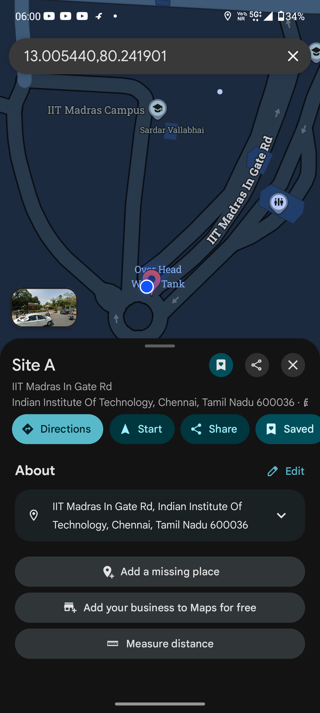
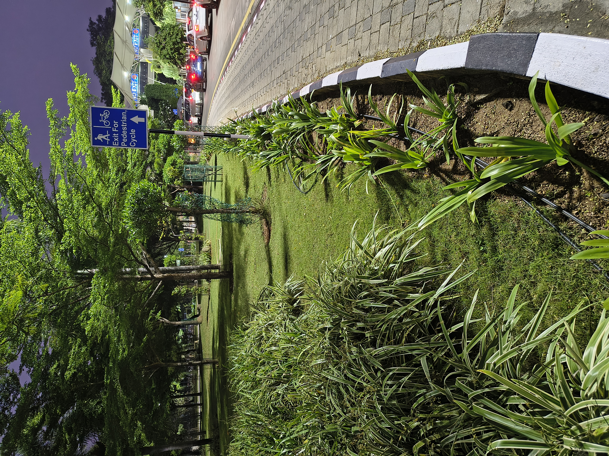
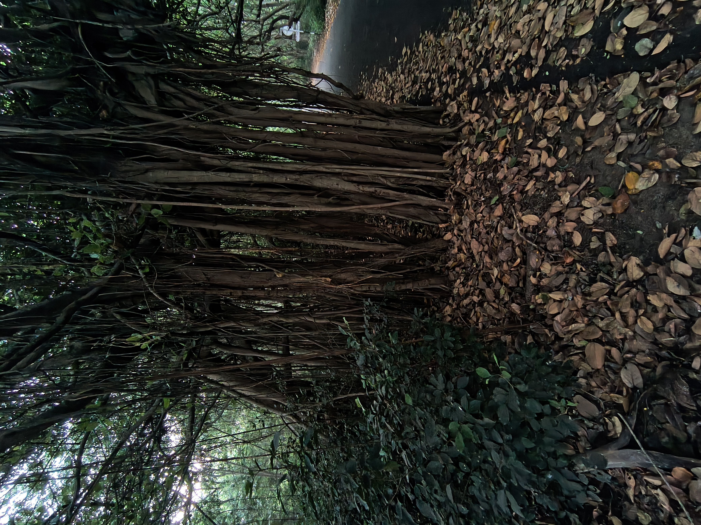

# NicheAcoustics: Evaluating the Acoustic Niche Hypothesis Across an Urban-to-Forest Gradient

**Author:** Ojasvi Kumar  
**Study Area:** IIT Madras Campus, Chennai, Tamil Nadu, India  
**Sampling Window:** 3 Consecutive Days (Thursday–Saturday) | Dawn (`06:00 IST`) & Dusk (`18:00 IST`) | `N = 18` 60-second uncompressed `.wav` recordings (`44.1 kHz`, Mono)

---

## 1. Overview & Motivation
Urban expansion and vehicular noise increasingly encroach upon peri-urban tropical forest ecosystems, compressing the spectral bandwidth available for wildlife communication. According to Bernie Krause's **Acoustic Niche Hypothesis (ANH)**, intact ecosystems exhibit frequency partitioning—where birds, insects, and amphibians occupy distinct non-overlapping acoustic bands—whereas anthropogenic noise ($0.1\text{--}1.5\text{ kHz}$) masks biological signaling ($2.0\text{--}8.0\text{ kHz}$).

**NicheAcoustics** is an end-to-end Python Digital Signal Processing (DSP) pipeline that quantifies spatial and diurnal soundscape recovery across a three-point urban-to-forest transect in Chennai using Short-Time Fourier Transform (STFT) power spectral density and three standardized ecoacoustic indices:
1. **Normalized Difference Soundscape Index (NDSI)**
2. **Acoustic Complexity Index (ACI)**
3. **Normalized Shannon Spectral Entropy ($H$)**

---

## 2. Field Study Sites & Habitat Documentation

| Site ID | Ecological Zone | Landmark / Location | GPS Coordinates | Habitat & Acoustic Profile |
| :--- | :--- | :--- | :--- | :--- |
| **Site A** | **Urban Perimeter Control** | IIT Madras In-Gate Road / Main Gate Roundabout | `13.005440, 80.241901` | Multi-lane paved entry roundabout adjacent to security gates and Sardar Patel Rd arterial traffic; sparse ornamental trees and manicured lawn strips. |
| **Site B** | **Buffered Campus Interior** | Ground Road near SAC Rd & Vindhya Mess | `12.990387, 80.235948` | Tree-lined internal campus road (~1.5 km from perimeter highways) flanked by dense shrubs, overhanging foliage, and damp wooded undergrowth. |
| **Site C** | **Deep Forest Refuge** | Madras Avenue (Guindy National Park Border) | `13.000776, 80.238422` | Closed-canopy tropical dry evergreen forest corridor with mature banyan aerial roots, thick leaf litter, and zero through-traffic. |

### Site Visual Documentation

#### Site A — Urban Perimeter (`13.005440, 80.241901`)
| GPS Pin | Ground Habitat View | 360° Horizon Panorama |
| :---: | :---: | :---: |
|  |  |  |

#### Site B — Buffered Campus Interior (`12.990387, 80.235948`)
| GPS Pin | Ground Habitat View | 360° Horizon Panorama |
| :---: | :---: | :---: |
|  |  |  |

#### Site C — Deep Forest Refuge (`13.000776, 80.238422`)
| GPS Pin | Ground Habitat View | 360° Horizon Panorama |
| :---: | :---: | :---: |
|  |  |  |

---

## 3. Signal Processing Methodology

All recordings were captured at `44.1 kHz` (16-bit PCM WAV) held horizontally at chest height (`1.3 m`) facing away from road edges. Each 60-second waveform $x[n]$ is transformed into a time-frequency power spectrogram $S[k, m] = \vert{}X[k, m]\vert{}^2$ using `n_fft = 2048` and `hop_length = 512`.

1. **Normalized Difference Soundscape Index (NDSI):**
   $$\text{NDSI} = \frac{B - A}{B + A} \in [-1, +1]$$
   where $A$ is integrated mean power in the anthropogenic band ($0.1\text{--}1.5\text{ kHz}$) and $B$ is integrated mean power in the biophonic band ($2.0\text{--}8.0\text{ kHz}$).

2. **Acoustic Complexity Index (ACI):**
   $$\text{ACI} = \sum_{k \in B} \frac{\sum_{m=1}^{M-1} \vert{}S[k, m+1] - S[k, m]\vert{}}{\sum_{m=1}^{M} S[k, m]}$$
   Quantifies rapid temporal intensity modulation characteristic of avian calls while remaining invariant to steady mechanical drone.

3. **Normalized Shannon Spectral Entropy ($H$):**
   $$H = -\frac{1}{\log_2(K)} \sum_{k=1}^{K} p_k \log_2(p_k), \quad p_k = \frac{\bar{P}[k]}{\sum_{j=1}^{K} \bar{P}[j]}$$
   Measures spectral evenness across $0.1\text{--}8.0\text{ kHz}$ ($H \to 1$ indicates multi-species frequency niche occupation; $H \to 0$ indicates narrowband dominance).

---

## 4. Quantitative Results & Spectral Partitioning Analysis

### 3-Day Diurnal Summary (`Thu–Sat` Averages)

| Site | Session | Mean NDSI | Mean ACI | Mean Entropy ($H$) | Dominant Acoustic Regime |
| :--- | :--- | :---: | :---: | :---: | :--- |
| **Site A** | Morning (`06:00`) | `-0.86` | `223.2` | `0.57` | Continuous traffic masking (`0.1–1.5 kHz`) |
| **Site A** | Evening (`18:00`) | `-0.87` | `227.0` | `0.53` | Peak commuter traffic roar (`+2 dB` low-end spike) |
| **Site B** | Morning (`06:00`) | `+0.51` | `250.0` | `0.82` | Multi-species avian dawn chorus (`2.0–5.0 kHz`) |
| **Site B** | Evening (`18:00`) | `+0.17` | `229.7` | `0.69` | Nocturnal insect/cricket chorus (`6.5–8.5 kHz`) |
| **Site C** | Morning (`06:00`) | `+0.50` | `239.4` | `0.78` | Dense forest canopy dawn chorus (`2.0–5.5 kHz`) |
| **Site C** | Evening (`18:00`) | `-0.56` | `217.7` | `0.57` | Post-dusk acoustic stillness (`-56 dB` noise floor) |

### 3-Day Mean Power Spectral Density (`0–10 kHz`, dB Scale)


### What the Spectral Partitioning Graph Shows
Plotting mean sound power on a logarithmic decibel ($\text{dB}$) scale reveals clear frequency-band separation across space (color) and time of day (solid vs. dashed lines):

1. **Anthropogenic Traffic Band (`0.1–1.5 kHz`, Grey Shaded Region):**
   * **Site A (Red curves)** dominates the low-frequency spectrum, peaking at **`+2 dB` in the evening** (dashed red) and **`-7 dB` in the morning** (solid red) due to continuous vehicle engines, horns, and tire rumble at the Main Gate roundabout.
   * **Sites B & C (Blue and Green curves)** drop by **`20–30 dB`** across this entire band (`-20` to `-46 dB`), confirming strong acoustic attenuation of urban traffic inside the vegetated campus interior.

2. **Avian Dawn Chorus Niche (`2.0–5.5 kHz`, Green Shaded Region — Solid Curves):**
   * At `06:00 IST`, **Site B Morning (solid blue)** and **Site C Morning (solid green)** rise sharply above their traffic baselines, forming broad, multi-peaked plateaus between **`-21 dB` and `-33 dB`** across `2.0–5.5 kHz` (with distinct vocal peaks near `2.4 kHz`, `3.7 kHz`, `4.2 kHz`, and `5.1 kHz`).
   * This elevated, broadband energy across multiple avian frequency channels directly drives the high **Shannon Entropy (`0.82` and `0.78`)** and **ACI (`250.0` and `239.4`)** recorded at dawn.

3. **Dusk Turnover: Insect Chorus vs. Forest Stillness (`2.0–8.5 kHz` — Dashed Curves):**
   * **Site B Evening (dashed blue)** demonstrates classic **temporal & spectral niche turnover**: while mid-frequency bird calls (`2.0–4.5 kHz`) subside to `-44 dB`, a prominent **nocturnal cricket/cicada chorus** emerges between **`6.5–8.5 kHz`**, peaking at **`-23 dB` around `7.7 kHz`** and keeping Site B's NDSI positive (`+0.17`).
   * **Site C Evening (dashed green)** exhibits **post-dusk ecological stillness**: once diurnal canopy birds roost at sunset, power across `2.0–4.5 kHz` drops to **`-50` to `-56 dB`** (the lowest noise floor on campus) without a loud high-frequency insect swarm—demonstrating how a silent forest dusk produces a negative NDSI ratio (`-0.56`) despite having virtually zero traffic noise.

---

## 5. Key Conclusions

1. **Acoustic Refuge Recovery Along the Spatial Gradient:** Moving from the urban perimeter (**Site A**: `-0.86` Morning NDSI) into the vegetated campus interior (**Sites B & C**) produces a **`+1.36` surge in Morning NDSI** (`+0.51` and `+0.50`), alongside substantial increases in **ACI** (`223.2` $\to$ `250.0`) and **Spectral Entropy** (`0.57` $\to$ `0.82`), confirming active avian niche partitioning across $2.0\text{--}5.5\text{ kHz}$.
2. **Diurnal Species-Guild Turnover (Site B vs. Site C):**
   * **Site B** exhibits **bimodal diurnal partitioning**: birds dominate the $2.0\text{--}5.0\text{ kHz}$ band at dawn (`+0.51`), while stridulating insects take over the $6.5\text{--}8.5\text{ kHz}$ band at dusk (`-23 dB` peak), maintaining positive biophonic dominance (`+0.17`) into the evening.
   * **Site C** operates as a **pure diurnal avian sanctuary**: strong dawn chorus activity (`+0.50`) gives way to deep post-dusk silence at `18:00` (`-56 dB` across $2\text{--}4\text{ kHz}$).
3. **Methodological Caution for NDSI in Ultra-Quiet Habitats:** Although `Site C Evening` has the lowest traffic power on campus (`-30` to `-46 dB` in $0.1\text{--}1.5\text{ kHz}$), its normalized NDSI evaluates to `-0.56` because diurnal birds have roosted ($B \to 0$) while a faint low-frequency background ambient floor remains. Pairing **NDSI with dB power spectra, ACI, and Entropy** prevents misclassifying a silent forest dusk as traffic-polluted.

---

## 6. Repository Structure & Usage

```text
NicheAcoustics/
├── assets/                   # Site maps, habitat photos, and 360° panoramas
├── data/
│   ├── raw/                  # 18 uncompressed 44.1 kHz mono .wav files
│   └── processed/            # ecoacoustic_summary.csv
├── outputs/
│   └── spectral_niches.png   # 3-day mean dB spectral partitioning figure
├── main.py                   # STFT, NDSI, ACI, Entropy & plotting pipeline
└── README.md